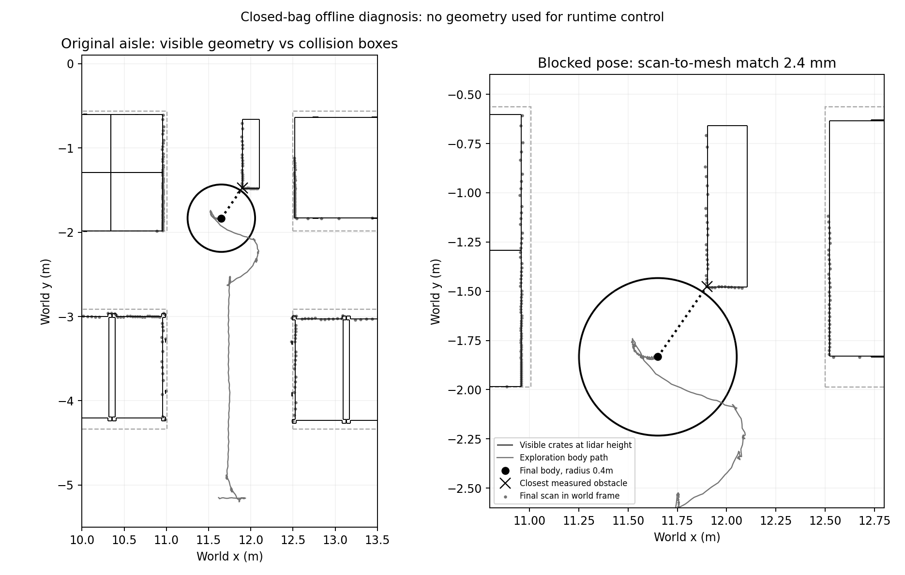

# 原仓库通道：可见货箱、碰撞代理与受保护脱困

原生窄口的 **1.492m 是两侧碰撞代理箱之间的间距，不能代表全程可见净宽**。上一轮卡点由通道内另一只倾斜货箱造成：GPU雷达看到了可见货箱网格，不能把这个回波当作错误障碍删除。



图中灰色虚线是世界文件中的四个碰撞代理箱，黑线是雷达高度的可见货箱截面；灰点为闭包扫描投影，圆为最终0.4m身体半径代理。仅用于离线诊断，不向运行控制提供真值或网格。

## 闭包核对

数据来自 `.runtime/corridor_episode_20261020/native_1/trial/` 已完整关闭的录包。机器人最后已静止；以最后独立身体姿态和实际静态雷达外参 `(0.22, 0, 0.09)` 投影，最近障碍距身体中心约0.4356m，世界坐标约 `(11.8996, -1.4753)`。身体高度约0.23m，雷达截面高度约0.32m。这里使用平面近似，不能将匹配距离当作测距精度标定。

缓存Depot版本6的 `Crates.dae` 使用厘米单位、节点矩阵及SDF缩放0.6，再叠加世界平移 `(7.19009, 1.09982, 0)`。最近回波与对应网格截面的距离约 **0.00244m**，与倾斜货箱边缘吻合。场景中的 `depot_collision` 只提供另一组代理箱，不能完整代表雷达可见表面。

在该高度、世界y=−1.3m的横截线上，左侧货箱边缘x≈10.9579m，倾斜货箱左边缘x≈11.9020m，两者间隙约 **0.9442m**；右侧间隙约0.4158m。这只是一个局部二维截面，不能当作整条路径最小净宽、身体全高度净空或物理碰撞证书。

0.8m身体直径与完整掉头所需空间不同。沿用雷达偏置0.22m、近裁剪0.30m和0.04m测距余量，完整旋转的传感器余量直径为1.12m，已经大于上述局部间隙；固定步态侧移还需要单独计入。因此不能要求机器人在任何能直行的位置都原地掉头，也不能用两侧外墙中心线覆盖倾斜货箱这一真实障碍。

## 脱困请求接入

旧逻辑在该姿态按两侧外墙请求“先转向通道中心”，最终保护因净空不足拒绝转向。身体当前前方却朝向远离货箱的一侧，已有净空恢复保护允许经完整扫描证明安全的纯前进，但此前上游没有发出这个请求。

现在启用 `guard.clearance_recovery_enabled` 且启用通道回中时，scaler会向回中状态机传入同一份完整扫描及正式保护参数。在已有转向请求期间，若测量净空位于身体半径加0.02m至身体半径加保护余量再加0.10m之间，并且既有扫描扫掠检查证明纯前进沿途净空不减、预测终点至少增加0.02m，则先停稳0.8秒，再请求既有标定前进量。达到上边界或证明不再成立时停车、稳定后交还导航。正式参数下该区间为 `[0.42, 0.55)`m；0.55m是恢复停止目标，不是完整掉头能力保证。

这个请求复用原12秒、每任务状态8次恢复预算，不在零请求、缺失/过期扫描、无确认通道、入口外或非活动任务中自行产生运动。规划层只证明静态扫描中的候选方向；唯一的最终velocity guard仍独立检查实际残余速度、扫描时延、健康状态和完整扫掠，可能拒绝该请求。没有增加执行器发布者、倒退或横移链路。

闭包卡点的静态反事实回放结果：旧请求 `(0, 0.3)` 被原保护以 `footprint_clearance` 拒绝；新请求经过原缩放得到 `(0.024, 0)`，原保护以 `clearance_recovery` 允许。回放假设残余速度为零，不能替代动态实测；测试另覆盖实际残余速度朝向障碍时最终保护继续拒绝。

## 实测转向包络与无限墙面

加入直行脱困后的首轮动态试验仍未通过：它走到了另一个卡点，没有触发新增脱困，返航因180秒验收等待超时结束。身体最近障碍实测约0.5827m，但墙面对拟合宽度约1.0167m、侧偏约−0.0012m，按无限延长墙面计算会禁止转向。这两种距离不是同一件事：拟合直线延伸到墙边空隙后，可能比所有实际障碍都更靠近身体。

后续修正保留传感器旋转包络 `sensor_radius + range_min + 0.04m`。若虚拟墙面宽度不足，则仅在同一份完整新鲜扫描证明**所有实际障碍点**都在该包络之外时交还正常转向；缺失完整扫描或实际最近点进入包络时继续停车。原卡点该包络约0.5600m，实测最近点约0.5827m。实际扫描上的静态回放从旧版 `turn_sensor_clearance` 变为正常转向，但身体转向侧移、遮挡后出现的障碍和后续扫描仍由实时保护检查，不能把单帧判断当作整个转向过程通过。

新增单元和真实DDS检查分别覆盖墙边空隙可转向、实际墙面仍禁止转向。DDS夹具雷达位于机身原点，使用0.48m近裁剪构造同一几何不等式；实际Go2雷达外参及0.30m近裁剪未改变。最初夹具使用0.30m近裁剪，未构造出预期的虚拟墙面阻塞，因此两项DDS检查失败；修正夹具后通过，失败日志与复核日志均保留。

目前对不满足完整旋转包络的情况仍保守拦截非零转向，包括部分小角度修正；没有实现根据实际所需转角、控制时域、残余步态侧移及传感器近裁剪共同计算的旋转扫掠。直行恢复的0.55m停止目标也不能保证满足0.56m完整传感器旋转余量。后续应联合核对按需转向包络、恢复停止目标及入弯前位置，不能把本次修正宣称为全部窄缝转向问题已解决。

## 复核工具

从本项目目录、已安装依赖的Python环境执行：

```sh
PYTHONPATH=. python3 scripts/audit_mesh_section.py \
  --mesh /path/to/Depot/6/meshes/Crates.dae \
  --scale 0.6 --translation 7.19009 1.09982 0 \
  --height 0.319999383793037 \
  --point 11.899598854819207 -1.4753387407568488 \
  --output crates-audit.json
```

工具只读本地文件，不下载模型或发布ROS消息，输出模型SHA256、截面及最近点。仅支持Z-up、矩阵变换和三角形COLLADA网格；遇到其他几何或变换编码会拒绝，避免静默产生不完整结果。几何变换、厘米单位、截面端点及不支持输入由10项回归覆盖。

原始扫描、静态反事实回放、截面、图和本轮动态试验在 `.runtime/corridor_geometry_20261020/`。精简结果见 [验证记录](native-aisle-geometry-validation.json)。

## 本轮动态结果

两个不同运行版本的原仓库试验都未完成第二排箱体穿越，返航180秒等待超时，最终身体误差分别2.709m、2.651m；不能据此计算同配置成功率。两轮都没有触发新增直行脱困或实测包络放行分支，动态能力尚未验收；这些分支目前只有真实DDS与闭包静态反事实证据。第二轮实际净空约0.553m，仍低于原0.56m完整旋转包络，保守停车符合当前逻辑。

最终Python完整回归640/640通过，JavaScript语法检查通过。两轮记录器及各七个运行子进程退出0，外层任务验收退出1，录包完整；各209个运行源文件前后哈希未变，ROS域228无残留节点。没有改动原世界、雷达近裁剪或身体保护阈值。接续工作优先验证有后方扫掠保护的有界倒退退出，再在开阔处处理转向。
