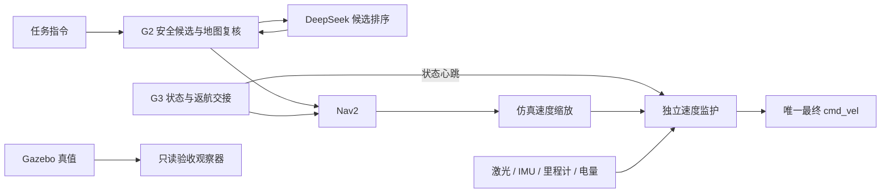

# 唯一导航主线与历史入口隔离

当前正式入口只有 `scripts/run_navigation_runtime.py`。普通启动、交互运行和当前验收都调用它；G2 是唯一探索目标发布者，G3 通过取消交接取得返航控制权。DeepSeek 默认只对 G2 生成的安全候选 ID 排序，确定性评分是同一 G2 模块内的回退或显式对照模式。

## 执行链与职责



正式运行栈启动 guard、模拟电量、scaler、G3、SLAM/Nav2、G2；DeepSeek 模式增加 Mission Brain 进程。两种排序模式使用相同的目标与速度执行链，不启动视觉 `nav_node`、`nav2_waypoint_bridge` 或直接速度控制器。

| 入口 | 当前用途 |
|---|---|
| `run_navigation_runtime.py` | 唯一正式进程编排，从 standby 等待任务命令 |
| `run_slam_frontier.sh` | 准备隔离仿真，随后调用同一个 runtime；默认采用统一 profile |
| `run_runtime_trial.py` / `validate_runtime.py` | 录包、发任务命令、观察和审计；不发布速度 |
| `validate_slam_frontier.py` | 兼容文件名，转调当前只读验收器 |
| `scripts/legacy/validate_slam_frontier.py` / `validate_amcl_navigation.py` | 冻结历史 Monitor 与复杂场景，必须显式历史开关 |
| `deepseek_nav2.launch.py` | 历史图像 waypoint 实验，默认关闭 |
| `robot_nav.launch.py` | 历史视觉到速度/SDK 实验，默认关闭 |

当前普通运行不再导入旧 Monitor。冻结的人物、推车、旧故障/返航实验没有偷偷迁入新运行栈，也没有重新运行；保留其代码和已有证据，显式历史复现时才允许旧执行逻辑。

## 统一配置与默认策略

`config/sim_runtime.yaml` 是基础配置，统一话题、坐标系、速度监护、缩放、Nav2 几何和速度、G3 健康预算与返航点、模拟电量，以及 `decision` 下的选择器、任务指令、模型与调用预算。

默认 `candidate_selector: deepseek`。CLI 选择器、任务指令和供应商环境变量的覆盖先合并到有效 profile，再生成参数与 hash。所有组件读取同一份 `runtime_profile.yaml` / `runtime_ros_params.yaml`，监护状态携带同一个配置 SHA-256；验收同时核对 profile、实际 ROS 参数、角色清单和 selector。

API key 仅来自环境，不写入配置、manifest 或命令行。通过主机 launcher 启动时复用项目 `.env`；独立启动 runtime 前须设置 `MISSION_BRAIN_API_KEY` 或已有 `DEEPSEEK_API_KEY`。模型地址和名称仍允许既有环境变量覆盖，并保存非秘密的有效配置。

本轮没有统一所有算法内部参数，也没有更改冻结的人物身份关联和动态障碍算法。只支持已经测量过的 `gazebo_go2` 仿真后端；仿真的 `.03` 速度限幅是步态输入幅度，不能当作实机米每秒。

## 启动与当前验收

在仓库的 `qwen_robotnav` 目录，使用现有 ROS/GPU enroot wrappers：

```bash
PYTHONPATH="$PWD:${PYTHONPATH:-}" python3 scripts/run_runtime_trial.py \
  /tmp/converged_navigation_new --domain 228 --goals 2
```

该命令默认真实调用 DeepSeek。显式 `--candidate-selector deterministic` 可做同一运行栈的对照；不会启用另一套导航实现。自动验收要求两个 geodesic≥0.75m 的探索目标、真实身体位移≥0.5m、返航 action UUID 成功、身体返航误差≤0.4m、唯一 guard 速度发布者、最终零指令和所有运行栈子进程退出 0。DeepSeek 模式还要求录包中至少一次真实、非回退的模型选择。

普通 shell 入口也默认走同一主线：

```bash
SLAM_ROS_DOMAIN_ID=228 ./scripts/run_slam_frontier.sh /tmp/navigation_new 2
# 交互方式从 standby 等待外部任务命令
SLAM_ROS_DOMAIN_ID=228 SLAM_RUNTIME_INTERACTIVE=1 \
  ./scripts/run_slam_frontier.sh /tmp/navigation_interactive_new 2
```

独立 runtime 入口在仿真已启动、私有 SLAM/Nav2 配置已生成并 source 对应 `progress_install/local_setup.bash` 的 ROS 环境中使用：

```bash
export PYTHONPATH="$PWD:$PWD/ros2_ws/src/qwen_robotnav_ros:${PYTHONPATH:-}"
python3 scripts/run_navigation_runtime.py \
  --profile config/sim_runtime.yaml --navigation-dir /tmp/prepared_navigation \
  --expected-domain 228 --enable-motion
```

运动默认关闭，只有显式 `--enable-motion` 才许可；之后仍受全部健康条件和任务状态约束。EXPLORE、RETURN、PAUSE、RESUME、ESTOP 通过配置的 `/g3/command` 进入 G3。初始地图 home 默认原点，换起点须配置并核对。

启动检查拒绝占用的运行角色及已有最终速度发布者；只能使用隔离 ROS 域与唯一 Gazebo partition。Bash 源先读入内存，退出时只回收本轮进程组。验收的 GT 仅用于姿态起始条件和独立测量，不进入生产运行栈。

## 速度保护和退出

最终输出由单独 `velocity_guard` 进程承担。指令、扫描、里程计、IMU、电量或 G3 心跳过期会输出零；暂停、待机、急停与未知状态也输出零。无效扫描不当作开阔区域，重复传感器时间戳不能刷新看门狗；倾角越限和多最终速度发布者会阻止运动。

前方间隙不足时停止平移、保留限幅转向；不支持未经验证的倒车。模拟电量复用已有 G3 节点并单独发布在 `/runtime/battery_state`，不使用共享仿真中 `present=false` 的固定消息作为有效 BMS。

G3 心跳及 guard 控制定时器使用单调时间。guard 在 SIGINT / SIGTERM 时先保持 ROS 上下文有效、发送零指令并给 DDS 传输窗口，再销毁节点和关闭 ROS。监督器和审计均检查每个预期子进程退出码，不能用总退出 0 隐藏 guard 退出 1。

IMU 倾角和里程计健康替代了旧 Monitor 的 GT 高度依赖；它们不等价于足端接触或站立高度测量。实机运动许可、执行端独立看门狗、SIGKILL/主机断电后的底层停机仍属于后续硬件适配范围。

## 历史模式与实验入口

历史复杂场景 runner 要求 `--legacy-validation`；手动 shell 复现则设置 `SLAM_LEGACY_VALIDATION=1`，并与正式 runtime profile 互斥。历史实现位于 `scripts/legacy/`，不作为正式功能扩展入口。

图像 waypoint launch 必须显式 `enable_experimental_waypoints:=true`，直接视觉速度 launch 必须显式 `enable_legacy_direct_control:=true`。它们启动前复用同一个排他检查，已有正式 G2/Brain/guard 或其他旧目标所有者时拒绝启动；旧 SDK bridge 也不再默认开启。本轮不启动这两种实验路径。

人物取证、动态障碍以及旧故障注入保持冻结，未声明已在新运行栈完成验收。原录包、失败样本和历史报告继续保留。

## 2026-10-16 收敛后的实测

最终验收目录 `.runtime/converged_runtime_v2/trial`，runner 与闭包审计均通过。2 个有效探索目标，3 次真实 `deepseek-flash` 候选选择、0 次回退，身体返航误差约 0.263m；真实返航 UUID `f16ee4cc31fa439a8ba58db956b7a9ef` 与 Nav2 成功状态对应。

运行栈七个进程（guard、battery、scaler、G3、SLAM/Nav2、Mission Brain、G2 frontier）全部退出 0。录包包含 2624 条最终速度指令，只有 guard 发布；验收器不发布速度，也不将 GT 接入运行栈。有效配置 SHA-256 为 `2a9c9f434239edc4ff5b516a7612c7c5678c2a22af77188c455771b87ad97621`，profile、生成参数、selector 与状态 hash 均一致。

保留之前两次不作为最终通过的记录：`.runtime/standalone_runtime_v1` 的运动与返航完成，但 guard 退出 1、旧汇总漏查子进程；`.runtime/converged_runtime_v1` 的 Gazebo 被 SIGKILL 终止，未进入任务或生成录包。没有修改旧记录使其变绿。

最终回归：导航 163、G3 241、G2 279 项通过，合计 683 项；ROS Python 包构建通过。另有独立子进程测试验证 SIGINT、SIGTERM 下发送零指令后退出 0。实测为独立一次普通仓库完整任务，不作为统计成功率或新运行栈故障注入/实机验收。
