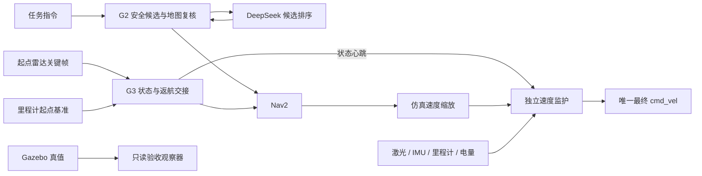

# 唯一导航主线与历史入口隔离

当前正式入口只有 `scripts/run_navigation_runtime.py`。普通启动、交互运行和当前验收都调用它；G2 是唯一探索目标发布者，G3 通过取消交接取得返航控制权。DeepSeek 默认只对 G2 生成的安全候选 ID 排序，确定性评分是同一 G2 模块内的回退或显式对照模式。

## 执行链与职责



正式运行栈启动 guard、模拟电量、scaler、G3、SLAM/Nav2、G2；DeepSeek 模式增加 Mission Brain 进程。两种排序模式使用相同的目标与速度执行链，不启动视觉 `nav_node`、`nav2_waypoint_bridge` 或直接速度控制器。

| 入口 | 当前用途 |
|---|---|
| `run_navigation_runtime.py` | 唯一正式进程编排，从 standby 等待任务命令 |
| `run_slam_frontier.sh` | 准备隔离仿真，随后调用同一个 runtime；默认采用统一 profile |
| `run_runtime_trial.py` / `validate_runtime.py` | 录包、发任务命令、观察和审计；不发布速度 |
| `validate_slam_frontier.py` | 兼容文件名，转调当前只读验收器 |
| `scripts/legacy/validate_slam_frontier.py` / `validate_amcl_navigation.py` | 冻结历史 Monitor 与复杂场景，必须显式历史开关 |
| `deepseek_nav2.launch.py` | 历史图像 waypoint 实验，默认关闭 |
| `robot_nav.launch.py` | 历史视觉到速度/SDK 实验，默认关闭 |

当前普通运行不再导入旧 Monitor。冻结的人物、推车、旧故障/返航实验没有偷偷迁入新运行栈，也没有重新运行；保留其代码和已有证据，显式历史复现时才允许旧执行逻辑。

## 统一配置与默认策略

`config/sim_runtime.yaml` 是基础配置，统一话题、坐标系、速度监护、缩放、Nav2 几何和速度、G3 健康预算与返航点、模拟电量，以及 `decision` 下的选择器、任务指令、模型与调用预算。

默认 `candidate_selector: deepseek`。CLI 选择器、任务指令和供应商环境变量的覆盖先合并到有效 profile，再生成参数与 hash。所有组件读取同一份 `runtime_profile.yaml` / `runtime_ros_params.yaml`，监护状态携带同一个配置 SHA-256；验收同时核对 profile、实际 ROS 参数、角色清单和 selector。

API key 仅来自环境，不写入配置、manifest 或命令行。通过主机 launcher 启动时复用项目 `.env`；独立启动 runtime 前须设置 `MISSION_BRAIN_API_KEY` 或已有 `DEEPSEEK_API_KEY`。模型地址和名称仍允许既有环境变量覆盖，并保存非秘密的有效配置。

## 返航定位闭环

正式 profile 启用 `return_localization`。每次从 `standby` 接受 `EXPLORE` 前，G3
必须同时取得新鲜的里程计、`map→odom` 和一帧有效激光扫描；它把当时的里程计
位姿保存为归位基准，把转换到机身坐标的扫描点保存为 home 关键帧。任一输入缺失时
拒绝开始任务，避免带着空基准出发。

返航不再一直发送配置文件中的固定地图原点。G3 使用当前 `map→odom` 变换重新表达
任务开始时的里程计 home，因此 SLAM 在探索期间调整地图坐标后，目标会随当前地图坐标
更新。Nav2 的 `succeeded` 只产生 `nav_succeeded_pending_verification`，此时任务仍保持
`RETURN`，不会进入 `STANDBY`，也不会触发模拟充电。

到点复核同时检查以下条件：

- 当前地图位姿位于本次实际发送的返航目标容差内；
- 当前里程计与任务起点基准一致；
- 机器人线速度和角速度低于静止阈值；
- 当前雷达扫描与起点关键帧的 ICP 匹配满足点数、内点率和 RMSE 门槛；
- `map→odom` 没有短时跳变或机器人静止时的持续漂移；
- 上述条件连续稳定 3 秒。

雷达判断机器人尚未真正到家时，G3 根据雷达估计的相对位姿生成当前地图坐标下的
修正目标，记录 `localization_rejected`，再通过同一个 Nav2 action 有限重试，默认最多
2 次。探索中出现定位跳变会先暂停并完成导航交接，定位连续稳定后才能恢复；返航目标
执行中出现跳变会取消旧目标，稳定后按新的 `map→odom` 重新发送 home。雷达确认已经
到家但地图或里程计坐标已跳变时，以雷达 home 为独立锚点重建本轮
home 坐标，并重新等待稳定窗口。超过修正次数、修正量越界、雷达匹配不可信、定位过期
或稳定确认超时都会发布 `localization_failed` 并进入 `ESTOP`，不会发布返航成功。

最终 `succeeded` 事件带有 `verification`，包含地图、里程计、雷达误差、匹配质量、稳定
时间和修正次数。诊断事件发布到 `/g3/localization_status`，统一录包和闭包审计要求存在
唯一的 `return_verified`，并继续用 Gazebo 真值独立检查身体归位误差；真值不进入运行栈。

这套闭环解决的是定位漂移造成的假返航成功，并可在 home 附近用雷达闭环修正。重复
几何环境仍可能让单帧雷达匹配产生歧义；实机若要求可证明的绝对归位，应把 AprilTag、
UWB 或充电桩定位作为额外独立锚点接入同一最终确认门。

本轮没有统一所有算法内部参数，也没有更改冻结的人物身份关联和动态障碍算法。只支持已经测量过的 `gazebo_go2` 仿真后端；仿真的 `.03` 速度限幅是步态输入幅度，不能当作实机米每秒。

## 启动与当前验收

在仓库的 `qwen_robotnav` 目录，使用现有 ROS/GPU enroot wrappers：

```bash
PYTHONPATH="$PWD:${PYTHONPATH:-}" python3 scripts/run_runtime_trial.py \
  /tmp/converged_navigation_new --domain 228 --goals 2
```

该命令默认真实调用 DeepSeek。显式 `--candidate-selector deterministic` 可做同一运行栈的对照；不会启用另一套导航实现。自动验收要求两个 geodesic≥0.75m 的探索目标、真实身体位移≥0.5m、返航 action UUID 成功、身体返航误差≤0.4m、唯一 guard 速度发布者、最终零指令和所有运行栈子进程退出 0。DeepSeek 模式还要求录包中至少一次真实、非回退的模型选择。

普通 shell 入口也默认走同一主线：

```bash
SLAM_ROS_DOMAIN_ID=228 ./scripts/run_slam_frontier.sh /tmp/navigation_new 2
# 交互方式从 standby 等待外部任务命令
SLAM_ROS_DOMAIN_ID=228 SLAM_RUNTIME_INTERACTIVE=1 \
  ./scripts/run_slam_frontier.sh /tmp/navigation_interactive_new 2
```

独立 runtime 入口在仿真已启动、私有 SLAM/Nav2 配置已生成并 source 对应 `progress_install/local_setup.bash` 的 ROS 环境中使用：

```bash
export PYTHONPATH="$PWD:$PWD/ros2_ws/src/qwen_robotnav_ros:${PYTHONPATH:-}"
python3 scripts/run_navigation_runtime.py \
  --profile config/sim_runtime.yaml --navigation-dir /tmp/prepared_navigation \
  --expected-domain 228 --enable-motion
```

运动默认关闭，只有显式 `--enable-motion` 才许可；之后仍受全部健康条件和任务状态约束。EXPLORE、RETURN、PAUSE、RESUME、ESTOP 通过配置的 `/g3/command` 进入 G3。初始地图 home 默认原点，换起点须配置并核对。

启动检查拒绝占用的运行角色及已有最终速度发布者；只能使用隔离 ROS 域与唯一 Gazebo partition。Bash 源先读入内存，退出时只回收本轮进程组。验收的 GT 仅用于姿态起始条件和独立测量，不进入生产运行栈。

## 速度保护和退出

最终输出由单独 `velocity_guard` 进程承担。探索和返航期间原始 Nav2 请求、缩放后指令、扫描、里程计、IMU、电量或 G3 心跳过期会输出零；暂停、待机、急停与未知状态也输出零。无效扫描不当作开阔区域，重复传感器时间戳不能刷新看门狗；倾角越限和多最终速度发布者会阻止运动。

整周扫描经实测 TF 投影到机身，结合里程计检查圆形 footprint、侧墙、预测运动和转向余移。前方或预测间隙不足时停止平移；只有机身净空和实测余移安全时保留限幅转向，低于硬保护线时两种速度均停止。不支持未经验证的倒车。模拟电量复用已有 G3 节点并单独发布在 `/runtime/battery_state`，不使用共享仿真中 `present=false` 的固定消息作为有效 BMS。

G3 心跳及 guard 控制定时器使用单调时间。guard 在 SIGINT / SIGTERM 时先保持 ROS 上下文有效、发送零指令并给 DDS 传输窗口，再销毁节点和关闭 ROS。监督器和审计均检查每个预期子进程退出码，不能用总退出 0 隐藏 guard 退出 1。

IMU 倾角和里程计健康替代了旧 Monitor 的 GT 高度依赖；它们不等价于足端接触或站立高度测量。实机运动许可、执行端独立看门狗、SIGKILL/主机断电后的底层停机仍属于后续硬件适配范围。

## 历史模式与实验入口

历史复杂场景 runner 要求 `--legacy-validation`；手动 shell 复现则设置 `SLAM_LEGACY_VALIDATION=1`，并与正式 runtime profile 互斥。历史实现位于 `scripts/legacy/`，不作为正式功能扩展入口。

图像 waypoint launch 必须显式 `enable_experimental_waypoints:=true`，直接视觉速度 launch 必须显式 `enable_legacy_direct_control:=true`。它们启动前复用同一个排他检查，已有正式 G2/Brain/guard 或其他旧目标所有者时拒绝启动；旧 SDK bridge 也不再默认开启。本轮不启动这两种实验路径。

人物取证、动态障碍以及旧故障注入保持冻结，未声明已在新运行栈完成验收。原录包、失败样本和历史报告继续保留。

## 2026-10-16 收敛后的实测

最终验收目录 `.runtime/converged_runtime_v2/trial`，runner 与闭包审计均通过。2 个有效探索目标，3 次真实 `deepseek-flash` 候选选择、0 次回退，身体返航误差约 0.263m；真实返航 UUID `f16ee4cc31fa439a8ba58db956b7a9ef` 与 Nav2 成功状态对应。

运行栈七个进程（guard、battery、scaler、G3、SLAM/Nav2、Mission Brain、G2 frontier）全部退出 0。录包包含 2624 条最终速度指令，只有 guard 发布；验收器不发布速度，也不将 GT 接入运行栈。有效配置 SHA-256 为 `2a9c9f434239edc4ff5b516a7612c7c5678c2a22af77188c455771b87ad97621`，profile、生成参数、selector 与状态 hash 均一致。

保留之前两次不作为最终通过的记录：`.runtime/standalone_runtime_v1` 的运动与返航完成，但 guard 退出 1、旧汇总漏查子进程；`.runtime/converged_runtime_v1` 的 Gazebo 被 SIGKILL 终止，未进入任务或生成录包。没有修改旧记录使其变绿。

最终回归：导航 163、G3 241、G2 279 项通过，合计 683 项；ROS Python 包构建通过。另有独立子进程测试验证 SIGINT、SIGTERM 下发送零指令后退出 0。实测为独立一次普通仓库完整任务，不作为统计成功率或新运行栈故障注入/实机验收。

## 自主结束探索与有界恢复

正式 profile 默认启用任务闭环，G2 和 G3 从同一配置同时启用。旧历史模式默认不启用，冻结的人物与动态障碍算法保持原有行为。

G3 每次从 standby 开始探索生成新 `session_id`，通过 `/g3/exploration_session` 发布；暂停和继续沿用任务编号。G2 收到编号后才允许本轮发点，并重置时间、访问记录和区域失败计数。G2 发布 `/exploration/completion`，G3 校验当前任务编号和结束原因，将结果发布到 `/g3/exploration_result`，再走原有 RETURN 取消交接。收到取消回执不等于释放控制权，必须等旧 action 真实终态；交接超时由 G3 进入 ESTOP。

| 原因 | 默认条件 | 结果含义 |
| --- | --- | --- |
| `no_frontiers` | 至少 3 个不同地图时间戳，跨越 ≥10 秒有效探索时间，最新地图已重新选点且持续无 frontier | `completed=true`，当前地图已无探索边界 |
| `time_budget` | 有效探索时间 ≥900 秒 | `completed=false`，时间预算到达后返航 |
| `coverage_stalled` | 已知面积连续 180 秒累计增长不足 0.5m² | `completed=false`，覆盖增长停滞后返航 |
| `candidates_unavailable` | `NO_CANDIDATE` 或 `SMALL_FRONTIERS` 持续 90 秒 | `completed=false`，当前无法继续探索 |
| `navigation_failures` | 连续 6 次导航失败或 action 服务不可用 | `completed=false`，导航失败预算耗尽 |

预算使用单调时钟，只累计 exploring 时间；暂停不消耗预算，继续不会清空失败计数。已知面积为 `非未知格数 × 分辨率²`，不把地图数组扩张当作覆盖增长，也不声称是实际场地覆盖率。SLAM 对地图的修正可能改变该面积，此指标用于判定持续收益停滞。

仅在地图与定位可用时提出自主返航；数据异常仍由现有 G3 健康检查、暂停恢复和速度监护处理。地图未到、位姿缺失、短期黑名单和小 frontier 不会被报告成探索完成。开始确认无 frontier 后，新地图必须重新选点；重复旧地图不能凑足确认帧。结果一旦产生即停止新目标和待定模型请求，重复探索心跳不能恢复发点。结束请求在 G3 暂停期间被拒绝时，恢复后重发请求。

失败目标保留原有 30 秒临时黑名单（ROS 时间），优先换其他安全候选；过期后允许重新选择该区域。同一任务内，半径 1 米的区域累计失败 2 次后隔离至任务结束，新任务才清除。连续失败另有总预算，不会无限重试同一区域。任务取消、返航抢占和结束时的取消不消耗导航失败次数。DeepSeek 超时继续使用同一 G2 内的确定性回退。

自动闭环验收使用：

```bash
PYTHONPATH=创新实践/external/go2_real_robot/qwen_robotnav \
python3 创新实践/external/go2_real_robot/qwen_robotnav/scripts/run_runtime_trial.py \
  /home/wy/data1/.runtime/autonomous_trial_NEW --domain 232 --autonomous-completion
```

观察器只发送 `EXPLORE`，结束清理时发送 `ESTOP`；不发送 `RETURN`。录包额外保存任务编号、结束请求和 G3 结果。闭包审计要求请求/结果编号与内容匹配、返航触发原因来自探索结束、录包内无外部 RETURN，且原有真实运动、至少 2 个有效目标、身体返航误差和七进程正常退出等要求继续成立。可用 `--profile` 指定单独的验收预算；不要通过改变目标数伪造自主完成。

ROS 协议测试使用合成静态地图、注入定位和假 action 服务，分别验证无 frontier 完成、预算到达取消在途目标及自动返航；这些测试不作为实际移动或覆盖率证据。普通仓库 Gazebo 的自动闭环验收单独记录。

### 自主任务验收（2026-10-16）

验收目录 `.runtime/autonomous_completion_v1/trial`，隔离 ROS 域 232。验收专用 profile 将有效探索预算设为 180 秒、覆盖停滞预算设为 240 秒；正式默认预算仍是 900/180 秒。闭包 15 项检查全部通过。

- 180.096 秒有效探索后自动以 `time_budget` 结束，`completed=false`，没有宣称仓库已经探完。
- 共完成 7 个目标，其中 5 个满足 geodesic≥0.75m 的有效目标要求；8 次真实 DeepSeek 选择，0 次回退。
- 取消第 8 个在途目标并等待真实取消终态后，G3 才发送返航目标。身体返航误差 0.233757m；返航 UUID `fdbb6c2f372a4bf9aa0a4fba315a78e0` 与 Nav2 成功终态一致。
- 原始命令话题只有 `EXPLORE` 和清理时的 `ESTOP`；真实返航触发原因为 `exploration:time_budget`。结束请求与 G3 结果的任务编号和内容一致。
- 唯一 guard 发布最终速度；5375 条最终指令，其中 4928 条非零。guard、battery、scaler、G3、Nav2、Mission Brain、G2 七个进程全部退出 0，录包正常关闭。
- 验收配置 SHA-256 为 `b883998089a8ee91be04bfdc3027505698ff236579ef2b33711663fdcf7e5910`。

本轮回归：G2 304、G3 251、导航 176 项通过，合计 731 项。三项真实 DDS/action 协议测试覆盖无 frontier、时间预算与连续导航失败后自动返航，使用合成地图、注入定位和假 action 服务；普通仓库实测覆盖的是时间预算自动返航。区域隔离、覆盖停滞与候选长期不可用有针对性回归，尚未进行各类真实场景的重复统计和实机验收。

联调还修正了已有返航客户端在通知成功后才释放活动目标的问题：现在先确认终态并清理，再通知 G3，避免成功退出 RETURN 时重复取消。一次 G3 回归在 ROS 原生垃圾回收层崩溃，日志 `.runtime/mission_completion_g3_final_tests.log` 保留；新测试保留真实导航客户端、仅替换测试方法后，独立完整复验通过，日志为 `.runtime/mission_completion_g3_verified_tests.log`。该崩溃运行不作为通过证据。

## 静态场景与路径可达性

正式 profile 进一步强制 `explorer.require_path_clearance: true`：候选选点、全图回退与延迟模型决策复核使用机器人净空路径。只对起点周围尚未完全观测的区域允许受限起步，且不放宽到已知障碍的净空。窄通道、死胡同与不可达窄口的独立判据、重复执行方法和实际结果见 [静态导航场景回归](static-navigation-validation.md)。普通仓库原有运动与返航判据保持。

执行轨迹的全周预测监护、实际行走覆盖增益和返航缺口验证见[执行净空验证](trajectory-clearance-validation.md)。
