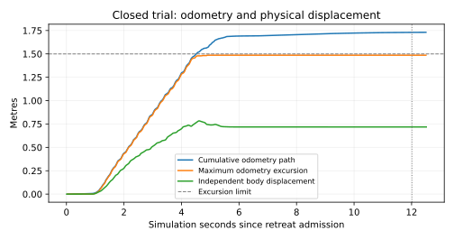

# 窄处直线倒退退出

已接入 `Nav2 → scaler → velocity_guard → cmd_vel` 原执行链：返航时沿最近走过的直线段后退，退到宽处停稳后交还Nav2转向、前进及归位验证。没有增加执行器发布者，没有启用通用曲线倒车。

**当前默认关闭。最终版本在私有1.2m通道连续两轮完整返航通过，完整回归685项通过。原仓库尚未按最终版本完成验收，不能据此宣称仓库自主返航问题已解决。**

## 当前验证结果

| 轮次 | 完整返航 | 负向执行样本 | 指令区间身体后退量 | 最大里程计位移 | 独立身体归位误差 |
| --- | --- | ---: | ---: | ---: | ---: |
| nav2_trial_9 | 通过 | 87 | 0.880m | 1.664m | 0.170m |
| nav2_trial_10 | 通过 | 87 | 0.937m | 1.680m | 0.190m |

两轮均通过真实G3的位置、朝向、里程计与LiDAR关键帧连续稳定验证，最终进入STANDBY；记录器及八个运行子进程退出0，录包完整，运行源码审计未变。私有ROS域228、229收尾检查均为空。身体运动使用关闭录包后的独立位姿分析，指令区间端点是近似值，停车滑移可能延伸到区间之后。

该试验使用私有世界副本：通道碰撞与可视墙同步收窄至1.2m，不是登记标准静态场景。测试客户端下发初始Nav2前进目标；G2保留建图与返航交接，通过私有任务话题覆盖禁用自主探索目标；RETURN由真实G3发给Nav2。没有注入速度、任务状态或真值控制。它验证的是倒退退出与真实返航闭环，不包含DeepSeek自主探索验收，也不是硬件验证。

## 准入与保护

- 必须处于RETURN，存在新鲜非零导航请求、完整新鲜扫描、新鲜有效里程计和Nav2路径；连续三份不同扫描确认后才能开始。
- 路径目标必须在身体后方至少0.25m，且 `abs(y) <= 0.12 + abs(x) * tan(0.2)`。这是返回方向提示，容纳已有0.12m横向定位误差；近处历史轨迹和完整后方扫掠独立复核。
- 当前位置距最近走过的轨迹不超过0.12m。倒退期间冻结原轨迹，验证局部直线方向；接近轨迹起点时可用同一条已走线段前方的点确认方向，不能以此越过当前位置与历史轨迹的距离限制。
- 历史轨迹检查忽略预测中心行程加0.02m以内的停车摆动，默认跨度0.22m、上限取身体保护半径；更远点的横向偏离不得超过0.12m。位置跳变超过0.35m或朝向跳变超过0.5rad会使轨迹失效。
- 后方完整身体扫掠包含保护余量、扫描时延及正负0.1rad/s小角速度滞后。进入原硬保护带时仍须满足原方向性净空恢复证明，身体保护半径加0.02m是最低边界。

先将两个指令斜坡降到零，等待0.8秒，再请求纯直退。原始请求−0.32经原scaler缩放为约−0.024；这是步态指令单位，不能当作物理m/s。最终保护独立复核完整扫描、实际残余速度、倾斜、新鲜度与发布者冲突；非RETURN、开关关闭、曲线倒退或缺少传感器继续拒绝。

## 配置与退出

| 参数或判据 | 当前值 | 含义 |
| --- | --- | --- |
| `navigation.reverse_retreat_enabled` | `false` | 唯一启用开关，必须是布尔值 |
| `navigation.reverse_retreat_max_extent_m` | `2.0` | 本次起点至当前点的最大滤波里程计位移限额；可配置范围0.5至2.0，旧profile缺字段时默认1.5 |
| 每次运动时间 | 12秒仿真时间 | 零请求暂停不重置原截止时间 |
| 每任务状态次数 | 最多2次 | 不因短暂零请求补充次数 |
| 是否需要倒退的净空判据 | 0.65m | 未启动时使用，不强迫居中的1.4m通道倒退 |
| 开始退出刹停的净空 | 0.81m | 原0.76m退出包络再加0.05m保护余量，给步态停车摆动留空间 |
| 刹停后交还控制的净空 | 至少0.76m | 连续三份新扫描合格，两个指令为零并停稳0.8秒后交还Nav2 |

`reverse_distance_m`保留每帧位移长度相加的原始累计路程作为诊断；`reverse_extent_m`记录相对本次起点的最大位移并执行限额，`reverse_extent_limit_m`发布当前配置值。两个量都不是身体物理位移保证，短暂零请求不重置起点或已用额度。

限额触发后不追加倒退请求。先用本帧完整扫描判断是否已到宽处：仍在窄处则锁止，已到宽处只可继续零请求停稳验证，发布 `reverse_exit_budget_stop`；净空丢失则锁止，不能重启倒退。停车滑移仍可能增加记录位移，限额不是身体停止距离保证。取消恢复后必须重新完成退出确认；未完成退出时路径变化也不会直接交还普通转向。

完整转向过程仍受实时保护。这是有界直退退出策略，机器人横着卡在弯道、历史轨迹弯曲或后方扫掠不安全时会拒绝；不能从任意卡点退出。

## 里程计偏差与修正依据

图来自后续第1轮。当时累计里程计路程约1.731m、最大位移约1.486m，独立身体位移约0.718m。因此同时存在累计摆动与尺度偏差，不能将里程计米数直接当身体米数。当前上游足端里程计 `QuadrupedOdometryNode.py` 使用 `contact_count += 0.65` 作为平均分母，会放大该步的平均足端位移；接触判定、滑移与EKF融合还影响实际误差。本次没有改动共享上游工作区，2m是有界仿真实验配置，不是完成物理标定的声明。

中间轮次保留了以下失败证据：原累计路程上限提前耗尽；接近轨迹起点时缺少圆外旧中心点而拒绝；远处路径方向提示未包含横向定位误差；预算检查早于本帧宽处检查；刚触及退出阈值就刹停，停车摆动后又失去净空。第6轮实际静态变换及最终保护记录证明，触发预算时净空已达0.82523m，检查顺序也确实会误锁。最终版本分别修正，并在身体扫掠和停稳交还阈值之外增加刹停余量。

私有步态脉冲标定还记录了−0.020、−0.024指令各1.5秒时约0.313m、0.342m身体后退量，横向偏移小于0.004m；这是短时仿真标定，不能作为所有场景的速度上界。原0.4m/s预测包络和实际残余速度检查保持。

## 验证与证据索引

最终完整Python回归685项通过，包含真实DDS取消恢复、后方障碍、扫描失效和宽处交还控制；配置范围、停车滞回、同帧到达宽处及超限、轨迹起点方向和路径变化均有针对性检查。

[验证索引](reverse-retreat-validation.json)保留初版提交64db3ad及后续各轮成功、失败和启动失败，按源码版本区分，不能合并计算统计成功率。初版原仓库真实DeepSeek试验失败且没有负向执行指令，不是最终版本的仓库通过证据。最终版本下一验收范围是原仓库及入口偏角变化。

大型录包、私有驱动、上游里程计只读快照、运行源码快照、源码哈希与完整日志保留在 `.runtime/reverse_20261020/` 和 `.runtime/reverse_followup_20261020/`。
